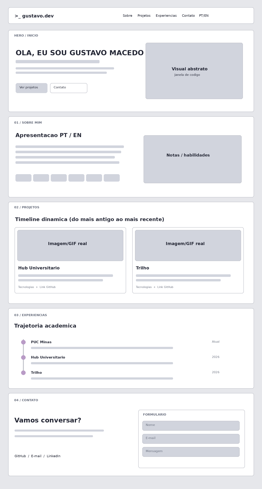
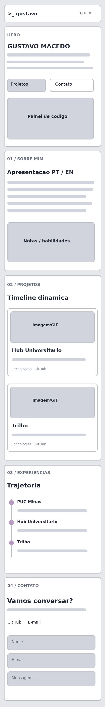
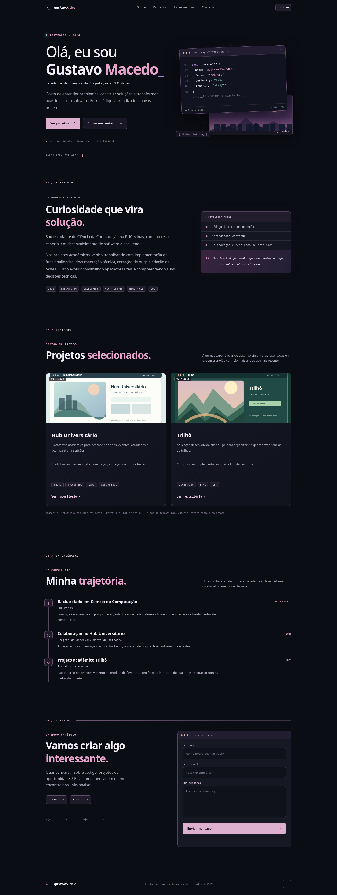

# Gustavo Macedo | Portfólio Profissional

> Portfólio desenvolvido para o Laboratório 01 da disciplina de Desenvolvimento de Interfaces Web (DIW), PUC Minas — 2026/2.

## Status

**Status:** Publicado na Vercel. Validação final das funcionalidades e do formulário de contato em andamento.

**Site online:** https://portfolio-owatsuki.vercel.app/

## Sobre o projeto

Página única de apresentação profissional com quatro seções navegáveis por âncoras: **Sobre Mim**, **Projetos**, **Experiências** e **Contato**. O design combina uma base minimalista dark com elementos de terminal, geometria retrô, tons lilás e detalhes ilustrativos inspirados em interfaces cozy/gamer.

### Funcionalidades

- Menu de navegação com âncoras e adaptação para telas pequenas.
- Seção Sobre Mim com alternância entre português e inglês, incluindo os demais textos da interface.
- Projetos carregados dinamicamente pelo JavaScript e classificados pela propriedade `sortDate` (ordem crescente).
- Experiências acadêmicas em formato de timeline.
- Links GitHub e contato.
- Formulário com campos nome, e-mail e mensagem, validação e integração preparada para envio via FormSubmit.
- Estados visuais de envio, erro e resposta do serviço, sem confirmação falsa de recebimento.

## Prototipação / Sprint 01

A prototipação de média fidelidade inclui as quatro seções nas versões desktop e mobile. As imagens abaixo são **bases de wireframe** para importar e organizar no Figma; a criação/registro do arquivo Figma ainda precisa ser realizada.

### Wireframe desktop



### Wireframe mobile



### Prévia da implementação



## Tecnologias utilizadas

| Tecnologia | Responsabilidade |
|---|---|
| HTML5 | Estrutura semântica, navegação e formulários |
| CSS3 | Layout responsivo, paleta, tipografia e componentes visuais |
| JavaScript | Internacionalização, timeline, menu e envio de formulário |
| FormSubmit | Serviço externo de recepção/encaminhamento de mensagens por e-mail |
| Git / GitHub | Versionamento e armazenamento do código |
| Vercel | Hospedagem estática de produção |
| Figma | Prototipação planejada, a ser registrada na ferramenta |

**Dependências:** nenhuma dependência npm, nenhuma etapa de build. Fontes DM Sans e IBM Plex Mono são carregadas do Google Fonts com alternativas de sistema.

## Arquitetura

```text
Navegador
 ├── index.html            → estrutura e quatro seções
 ├── style.css             → layout, identidade visual e responsividade
 └── script.js             → dados, idioma, timeline, contato
      └── POST HTTPS → FormSubmit → caixa de e-mail configurada

GitHub → Vercel → site estático publicado
```

**Decisão arquitetural (ADR-001):** uma única página HTML com quatro seções independentes e navegação por âncoras. A opção diminui complexidade e mantém navegação funcional, com adequação ao escopo desta atividade. O enunciado usa tanto a expressão “seções” como “páginas”; caso o professor exija múltiplas páginas HTML, a arquitetura deverá ser adaptada.

## Estrutura de diretórios

```text
portfolio-gustavo/
├── index.html
├── style.css
├── script.js
├── vercel.json
├── .gitignore
├── assets/
│   ├── favicon.svg
│   ├── hub-preview.svg
│   └── trilho-preview.svg
├── docs/
│   ├── wireframe-desktop.png
│   ├── wireframe-mobile.png
│   ├── site-desktop-preview.png
│   └── site-mobile-preview.png
├── README.md
└── GUIA-ENTREGA.md
```

## Instalação e execução local

Pré-requisito: navegador moderno. O servidor local é opcional; recomendamos Python 3 caso esteja instalado.

```bash
cd portfolio-gustavo
python3 -m http.server 8000
```

Acesse `http://localhost:8000`. Para encerrar, pressione **Ctrl+C** no terminal.

Sem Python, abra `index.html` diretamente no navegador. Nenhuma instalação de dependência é necessária.

## Configurar formulário de contato

O formulário **não envia mensagens até que seja configurado e ativado**.

1. O e-mail de destino já está configurado em `script.js`: `guccs.cina@gmail.com` (visível no site e no código).
2. Faça uma primeira tentativa de envio no site para o FormSubmit enviar uma mensagem de ativação.
3. Confirme a ativação seguindo o e-mail recebido.
4. Envie uma **segunda mensagem de teste**, conferindo caixa de entrada e spam.
5. Só marque o formulário como concluído depois de receber o teste. Nunca inclua senhas ou chaves privadas no código.

O serviço utilizado: https://formsubmit.co/ . Por ser uma integração externa, depende de conectividade e do funcionamento do provedor.

## Dados reais pendentes de conferência

- [ ] Confirmar ordem cronológica exata de **Hub Universitário** e **Trilhô**. Datas provisórias em `PROJECTS.sortDate`.
- [ ] Substituir as imagens SVG ilustrativas dos projetos por **capturas de tela reais ou GIFs de funcionamento** e atualizar os caminhos em `script.js`.
- [ ] Confirmar as tecnologias listadas para o Trilhô e os detalhes de suas contribuições.
- [x] Configurar e-mail de contato (`guccs.cina@gmail.com`).
- [ ] Ativar FormSubmit e verificar recebimento real. LinkedIn opcional em `CONFIG.LINKEDIN_URL`.
- [ ] Criar o arquivo de wireframes no Figma e guardar o link nele.
- [x] Publicar o portfólio na Vercel e registrar a URL no README.
- [ ] Executar e registrar testes da versão publicada (formulário, idioma, navegação, imagens e mobile).

## Projetos em destaque

- **Hub Universitário:** [GitHub](https://github.com/DanielFigues/hub-universitario). Colaboração em back-end, testes, documentação e correções.
- **Trilhô:** [GitHub](https://github.com/ICEI-PUC-Minas-CC-TI/plu-cc-2026-2-ti2-4354100-plu-cc-2026-2-ti2-4354100-group-1). Colaboração no módulo de favoritos.

## Testes e critérios de qualidade

Testes locais básicos executados com navegador automatizado: renderização dos dois cards, alternância de idioma, menu mobile e ausência de rolagem horizontal a 390 px. Verificou-se também a mensagem de bloqueio quando o e-mail do formulário não está configurado. **Isso não substitui o teste de envio real nem a validação em produção.**

Recomendamos testar também a 320 px, 768 px e 1440 px, inspecionar o console de erros, navegar por teclado e confirmar todos os links públicos.

## Deploy

Importe o repositório GitHub na Vercel e utilize:

- Framework Preset: `Other`.
- Root Directory: diretório raiz.
- Build Command: vazio (sem build).
- Output Directory: `.` (raiz).

O `vercel.json` já indica `framework: null` e `outputDirectory: "."`.

## Documentação e referências

- Enunciado: Laboratório 01 — Portfólio Profissional, DIW, PUC Minas.
- [Template acadêmico de README do professor João Paulo Aramuni](https://github.com/joaopauloaramuni/desenvolvimento-de-interfaces-web/blob/main/TEMPLATES/template_README.md).
- [Vercel](https://vercel.com/docs/builds/configure-a-build).
- [FormSubmit](https://formsubmit.co/documentation).

## AI Usage

Foi utilizada assistência de inteligência artificial no planejamento, na exploração das propostas visuais, na elaboração da versão inicial do código e na estruturação da documentação. A revisão de informações pessoais, os testes de serviços externos e a submissão final permanecem sob responsabilidade do autor.

## Autor

Gustavo Macedo — estudante de Ciência da Computação, PUC Minas.

## Melhorias futuras (não implementadas)

- Tema claro e tema retrô/8-bit, além do dark atual.
- Microanimações originais inspiradas em café, gatos e games, sem reproduzir material protegido de terceiros.
- Domínio `.dev` próprio. Por enquanto, publicar em `*.vercel.app`: o domínio `.dev` requer registro/aquisição e configuração de DNS/HTTPS na Vercel.
